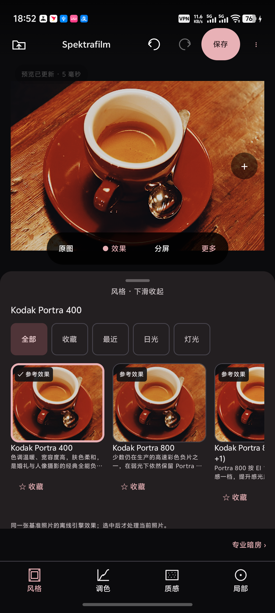

# Spektrafilm Android 简体中文版 UI v2

此分支基于官方 v0.10.0（d7f9fcf86213c9dc46d2a2b5ddfa41dc8040ef0e），版本为0.10.0-cn.2 / versionCode13。是独立签名的中文改版，非官方发行。

- 923条简体中文资源及帮助、胶片/预设显示文本汉化，内部ID保留。
- 深色底与柔和粉色强调色，大图、可收起面板、风格/调色/质感/局部四项导航及专业暗房。
- 28张实际引擎离线生成的固定参考图，收藏、最近使用和日光/灯光分类；滚动不渲染用户照片。
- 常用参数与单项重置，复用预设强度、撤销/重做、完整专业参数和旧编辑格式。
- 明确的原图/效果/分屏入口，相册导出、高级格式设置、查看/分享结果。

## 构建与验证

使用完整JDK21、Gradle9.5.1、AGP9.3.2、Kotlin2.2.10、compileSdk37、targetSdk36、minSdk24、NDK28.2.13676358及CMake3.22.1。Android SDK路径放入不提交的local.properties。Windows需GNU patch，并建议短路径工作目录以避免旧Ninja的260字符限制。

`gradlew.bat :app:assembleRelease :app:testDebugUnitTest`

已完成基线编译、最终Release构建、632项单元测试及vivo覆盖安装/操作。JPEG及合成DNG导入、调节、收藏、对比、JPEG/PNG相册导出、查看和分享面板已测试。完整边界见[验证报告](docs/android-cn-ui-v2/verification.md)。16KB仅完成静态对齐，未在16KB设备运行；未穷举所有相机RAW与高级参数组合。

参考图来源/参数/复现见[生成工具](tools/film-references/README.md)。原始C++引擎、JNI、RAW解码和旧数据schema未改变。

## 安装与签名

汉化正式包沿用已有cn.1密钥，可覆盖安装，无须卸载。官方包与此汉化包签名不同，不能互相覆盖；请勿卸载应用来解决签名冲突，以免丢失本地记录。

APK不提交到Git历史。已验证交付APK SHA256：E427A8E956B6CC2B3A7391DFE319FA119C5F1BFC995AD8750AA9231D6CD87362。
正式签名密钥、密码和本机DPAPI文件不在仓库。无本机签名配置时Release默认产出未签名APK。

Spektrafilm for Android by Akshay Sharma — https://github.com/thetechgeekko/Spektrafilm-android

Film modeling powered by spektrafilm (Andrea Volpato) — https://github.com/andreavolpato/spektrafilm

GPLv3；保留原README、LICENSE、NOTICE与所有适用许可证。
